<!-- ========================================================= -->
<!--                          HERO                             -->
<!-- ========================================================= -->

  

<!-- ========================================================= -->
<!--                        INTRO                              -->
<!-- ========================================================= -->

<table align="center" width="96%">
<tr>
<td width="58%" valign="top">

<h2>Building for the web &amp; the cloud</h2>

I'm a <strong>Cloud &amp; Full-Stack Engineer from Sri Lanka</strong> who turns
ideas into fast websites, smart AI chatbots and reliable cloud systems.

From a small business's first online store with <strong>WhatsApp ordering</strong>
to <strong>CI/CD pipelines on Azure and AWS</strong>, I care about clean code,
real results and shipping things people actually use.

<table>
<tr>
<td><strong>Frontend</strong> Next.js · React · Angular · Flutter</td>
<td><strong>Backend</strong> Node.js · Laravel · Go · gRPC</td>
</tr>
<tr>
<td><strong>Cloud</strong> Azure · AWS · Docker · Kubernetes</td>
<td><strong>AI</strong> Chatbots · Telegram bots · TensorFlow</td>
</tr>
</table>

<strong>Microsoft Student Ambassador</strong> · SLTC Research University 
Writing tutorials at <a href="https://sandeepa.online/blog">sandeepa.online/blog</a> 
<em>Fun fact: I can debug code faster than I can decide what to eat.</em>

</td>
<td width="42%" align="center">

  

</td>
</tr>
</table>

<!-- ========================================================= -->
<!--                   TECHNOLOGY MATRIX                       -->
<!-- ========================================================= -->

  

<!-- ========================================================= -->
<!--                      WHAT I BUILD                         -->
<!-- ========================================================= -->

  

<!-- ========================================================= -->
<!--                     FEATURED WORK                         -->
<!-- ========================================================= -->

<h2 align="center">Featured Work</h2>

<table align="center" width="96%">
<tr>
<td width="50%" valign="top">
<h3>Gaming 6T6 YT Store</h3>
Next.js · WhatsApp ordering

Game top-up store where customers order in one tap via WhatsApp.

</td>
<td width="50%" valign="top">
<h3>EuroMatch</h3>
Next.js

Football match platform built with Next.js.

</td>
</tr>
<tr>
<td width="50%" valign="top">
<h3>AI &amp; Chatbot Solutions</h3>
AI · Node.js

Custom AI assistants that answer customers on business websites.

</td>
<td width="50%" valign="top">
<h3>School &amp; Business Sites</h3>
React · Next.js

Fast, SEO-friendly websites delivered for real clients.

</td>
</tr>
</table>

<a href="https://sandeepa.online/portfolio"><b>Explore all projects →</b></a>

<!-- ========================================================= -->
<!--                      OBSERVABILITY                        -->
<!-- ========================================================= -->

<h2 align="center">Activity</h2>

  
  

  

  

<!-- ========================================================= -->
<!--                        DEV PETS                           -->
<!-- ========================================================= -->

  

<!-- ========================================================= -->
<!--                        CONNECT                            -->
<!-- ========================================================= -->

  

  
  
  
  
  

